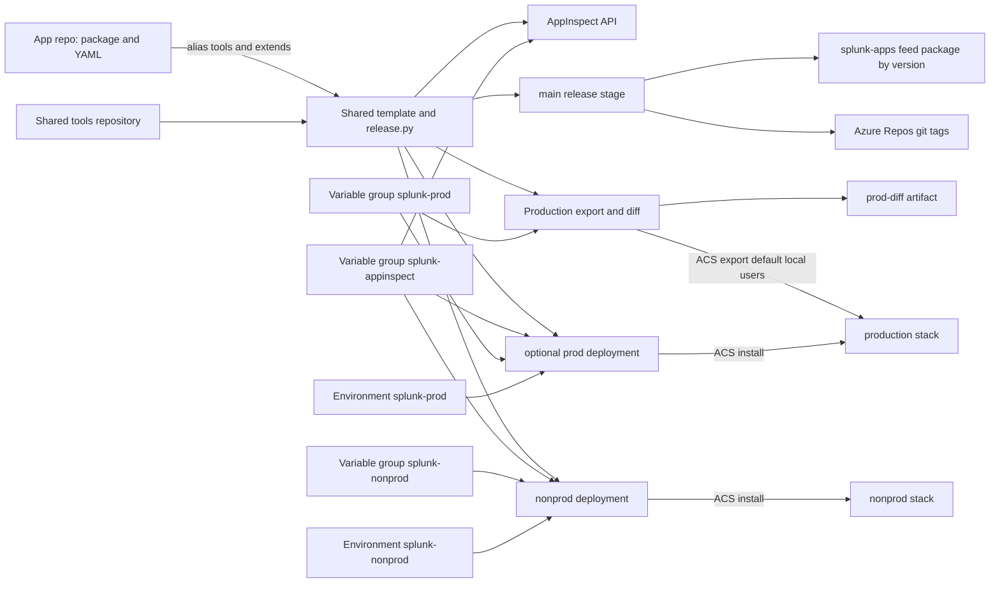
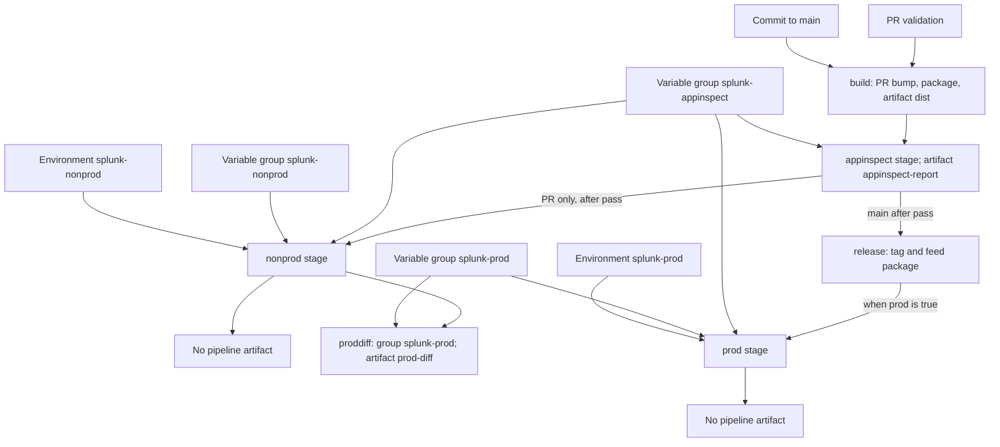

# azure-pipelines-splunk-apps

This repository provides a shared Azure Repos and Azure Pipelines release
pipeline for Splunk apps. An app team keeps its source in `package/` and gets
pull request validation, release packages, tags, and an optional production
deploy.

## Installation

1. Open **Repos → Files → repository selector → New repository** in
   `<project>`. Create `azure-pipelines-splunk-apps` and push this shared
   repository to `main`.
2. Open **Pipelines → Library → + Variable group**. Create the three groups
   listed in Setup reference and mark passwords and tokens secret.
3. Open **Repos → Files → repository selector → New repository**. Create an app
   repo with `package/default/app.conf` and copy
   `example/azure-pipelines.yml` to `/azure-pipelines.yml`.
4. Open **Pipelines → New pipeline → Azure Repos Git** and select the app repo.
   Choose **Existing Azure Pipelines YAML file** and `/azure-pipelines.yml`;
   authorize the shared repo, groups, and environments.
5. Open **Repos → Branches → main → Branch policies → Build validation → +**.
   Choose the pipeline and set an automatic, required policy.
6. Open **Repos → Pull requests → New pull request**. Select the app branch and
   `main`, then create the PR.

## How it works

### The two repositories

Each app repo stores the app under `package/` and has a small
`azure-pipelines.yml`. Its `resources.repositories` entry checks out the shared
repo under the alias `tools`; `extends` selects
`templates/splunk-app.yml@tools`. The shared template runs the same release
script for every app repo.

The app id comes from `[id] name` in `package/default/app.conf`; if it is
missing, the script uses the Azure Repos repository name, then the working
directory name. Both `[launcher]` and `[id]` must have matching `version`
values for packaging and release; a PR bump updates both.

### How the repositories and services connect



### Pull request and main run stages

Azure Repos queues pull request validation from the target branch's build
validation policy. The example YAML's `trigger` queues builds for commits to
`main`; Azure Repos does not use a YAML `pr:` trigger.



**build** runs for both PR and `main`. On a PR, `release.py bump` compares
the app version with the target branch. If they match, it bumps patch by
default, or minor or major when the commit message contains `[minor]` or
`[major]`, updates both version rows and regenerates `app.manifest`. It commits
and pushes those files to the PR source branch. If the target file is missing
or the PR already changed the version, it skips the bump. The stage then
packages the app and publishes the `dist` artifact, which contains
`<app-id>-<version>.tar.gz`. Find it in the pipeline run's **Artifacts**.

**appinspect** downloads `dist` and uses `splunk-appinspect` to get an
AppInspect API token from the Splunk username and password, then submits the
package with the AppInspect `cloud` tag (the Splunk Cloud vetting checks).
The stage passes only when AppInspect reports `SUCCESS` with zero failures and
errors. It prints the JSON summary and publishes the
`appinspect-report` artifact with the HTML and JSON reports when they were
produced. Find it in the run's **Artifacts**.

**nonprod** runs on PRs after AppInspect passes. It uses the
`splunk-appinspect` and `splunk-nonprod` variable groups and the
`splunk-nonprod` environment. The job installs the `dist` package on the
configured `<stack>` through ACS. It leaves deployment logs in the run and
publishes no artifact.

**proddiff** follows a successful nonprod deployment. It uses the
`splunk-prod` variable group to export the production app through ACS,
including `default`, `local`, and `users` content, then compares that export
with the package in `dist`. The `prod-diff` artifact contains
`prod-diff.patch` and, when export succeeds, `<app-id>-prod.tgz`. Find it in
the run's **Artifacts**. The export step can continue after an error; without
an export archive, the diff shows package files as additions.

**release** runs on `main` after AppInspect passes. It tags the current commit
`v<version>`, then publishes the package as a Universal Package to the
`splunk-apps` feed. The feed package name is the lowercase app id and its
version is the app version. The source tag and feed version identify the same
release: use **Repos → Files → Compare** to compare two tagged releases, and
**Artifacts → splunk-apps → `<app-id>` → `<version>`** to download a package.
The tag push is rejected if that version already tags a different commit.

**prod** is optional and only follows a successful `main` release. Set
`prod: true` under the template parameters in the app repo to enable it. It
uses `splunk-appinspect` and `splunk-prod` plus the `splunk-prod` environment
to install the package on the configured production `<stack>`. It publishes
no artifact. Pull request runs do not deploy to production.

### Variable groups, environments, and targets

- `build` uses no variable group or environment.
- `appinspect` uses `splunk-appinspect` and the AppInspect API.
- `nonprod` uses `splunk-appinspect`, `splunk-nonprod`, and the
  `splunk-nonprod` environment.
- `proddiff` uses `splunk-prod` for the production ACS export; it has no
  environment.
- `release` uses no variable group or environment; it writes a Git tag and
  publishes to `splunk-apps`.
- Optional `prod` uses both appinspect and prod groups plus the
  `splunk-prod` environment.

A deployment stage also uses the stack named by `SPLUNK_STACK`. This template
does not define an Azure DevOps service connection; it reads credentials from
variable groups.

### release.py commands

- `bump` updates matching app versions and the manifest on a PR source branch,
  then commits and pushes them.
- `package` copies `package/` into an app-named directory, excludes dotfiles,
  tests, and compiled Python files, then writes a normalized tarball under
  `dist/`.
- `appinspect <dir>` submits a package, polls its result, and writes HTML and
  JSON reports into `<dir>`.
- `deploy <dir>` installs the tarball through ACS using the configured stack
  and credentials.
- `export <dir>` downloads the installed app with its `default`, `local`, and
  `users` content.
- `diff <pkg-dir> <dir>` compares a package with an optional production export
  and writes `prod-diff.patch`.
- `tag` pushes `v<version>` for the current commit and sets `APP_ID` and
  `APP_VERSION` for the feed step.

### Why each piece exists

- The shared tools repo keeps one release pipeline and script for all app repos.
- The app repo keeps the package content and points to the shared template.
- The build stage creates one versioned package for validation and release.
- AppInspect checks the package before a deployment or release can continue.
- The nonprod stage installs the PR package on a test stack before merge.
- The production diff exists because changes made in Splunk Web live only in
  production.
- Git tags identify the source commit for each release version.
- The feed stores the package built for each release version.
- The optional prod stage installs a released package on production after the
  main run passes.

## Setup reference

### App repository files

Create this layout in each app repo:

```text
<app-repo>/
├── azure-pipelines.yml
└── package/
    └── default/app.conf
```

The two version values must match for packaging and release. The id name
becomes the package id; if omitted, the repository name is used. A PR bump
updates both version values when they still match the target branch.

```ini
[id]
name = <app-id>
version = 1.0.0

[launcher]
version = 1.0.0
```

The example YAML points to the shared repo as
`azure-pipelines-splunk-apps`. If the shared repo is in a different project,
set its resource name to `<project>/azure-pipelines-splunk-apps` and grant the
pipeline Build Service read access to that repo.

### Variable groups

Open **Pipelines → Library → + Variable group**. Use these exact names and
mark passwords and tokens secret.

| Group | Variables |
| --- | --- |
| `splunk-appinspect` | `SPLUNK_USERNAME` (plain), `SPLUNK_PASSWORD` (secret) |
| `splunk-nonprod` | `SPLUNK_STACK` (plain), `ACS_TOKEN` (secret) |
| `splunk-prod` | `SPLUNK_STACK` (plain), `ACS_TOKEN` (secret) |

Create an ACS token for each `<stack>` with the `acs` audience. The production
token also needs the `export_apps` capability for the ACS export in
`proddiff`. Authorize the pipeline to use each variable group under its
**Pipeline permissions** tab.

### Environments and feed

Open **Pipelines → Environments → Create environment** and create
`splunk-nonprod` and `splunk-prod`. Authorize the pipeline to use both. Add
approval checks to `splunk-prod` if production deployment needs approval.

Open **Artifacts → Create Feed**, create a project-scoped feed named
`splunk-apps`, then open **Feed settings → Permissions**. Give the pipeline
Build Service the **Feed Publisher (Contributor)** role. The release stage
publishes Universal Packages to this feed.

### Build Service permissions

In **Project settings → Repositories → `<app repo>` → Security**, grant the
pipeline Build Service **Contribute** on the app repo or PR source branches so
`bump` can push its release commit. Grant **Create tag** on the repo so the
`main` release can push `v<version>`.

The identity is usually `<project> Build Service (<org>)`; if the pipeline uses
the collection identity, grant the matching
`<org> Project Collection Build Service (<org>)`. Also authorize the pipeline
to read the shared tools repo when prompted.

### Branch policy and agent

Open **Repos → Branches → main → Branch policies → Build validation → +**.
Select the pipeline and choose automatic queueing. Make the policy required or
optional. This policy queues PR validation; the example YAML separately
triggers builds for commits to `main`.

The default pool is Microsoft-hosted `ubuntu-latest`. A self-hosted agent needs
Git, Python 3.13, and outbound HTTPS to `pypi.org`, `api.splunk.com`,
`appinspect.splunk.com`, and `admin.splunk.com`. The pipeline installs
`splunk-packaging-toolkit` from PyPI.

## Usage

From an app repo root, install the package toolkit and build the archive:

```sh
python -m pip install splunk-packaging-toolkit
python <path-to-shared-repo>/release.py package
```

From the shared repo root, run the self-check:

```sh
python test_release.py
```

`.env.example` lists environment variable names with placeholders. AppInspect
and `deploy` need `SPLUNK_USERNAME` and `SPLUNK_PASSWORD`; `deploy` and `export`
also need `ACS_TOKEN` and `SPLUNK_STACK`.

- Version mismatch: match `[launcher]` and `[id]` versions in `app.conf`.
- Bump skipped: the PR version differs from the target, or the target has no
  `app.conf`.
- Git push denied: grant the Build Service **Contribute** on the PR source
  branch.
- AppInspect fails: check credentials and download the `appinspect-report`
  artifact.
- ACS returns 401 or 403: check the ACS token, `acs` audience, and the
  production `export_apps` capability.
- ACS returns 404: check that `SPLUNK_STACK` names the intended stack.
- Production stage does not run: set `prod: true` and confirm the run is from
  `main`.
- Pipeline needs permission: authorize the shared repo, variable groups,
  environments, and feed.

## License

[Apache License 2.0](LICENSE)

Documentation: <https://docs.jacobpevans.com>
