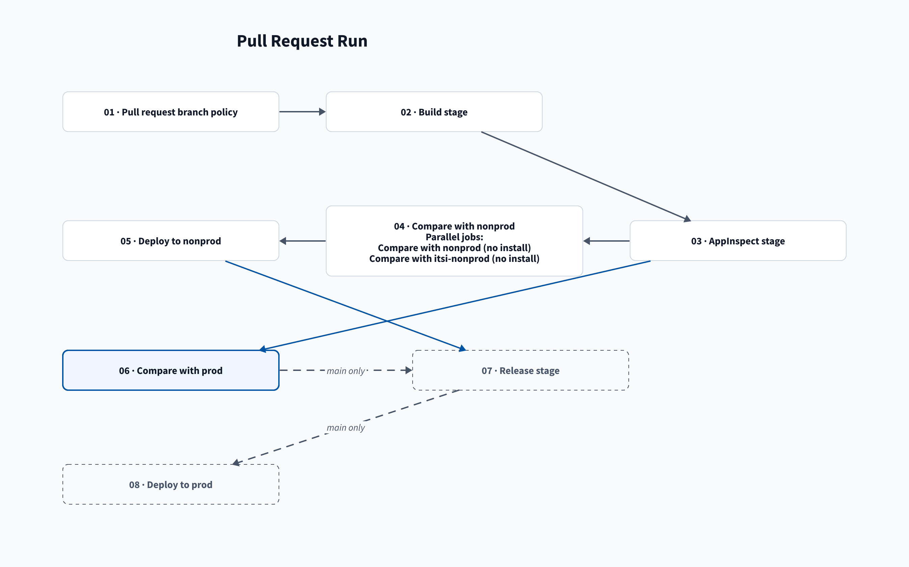
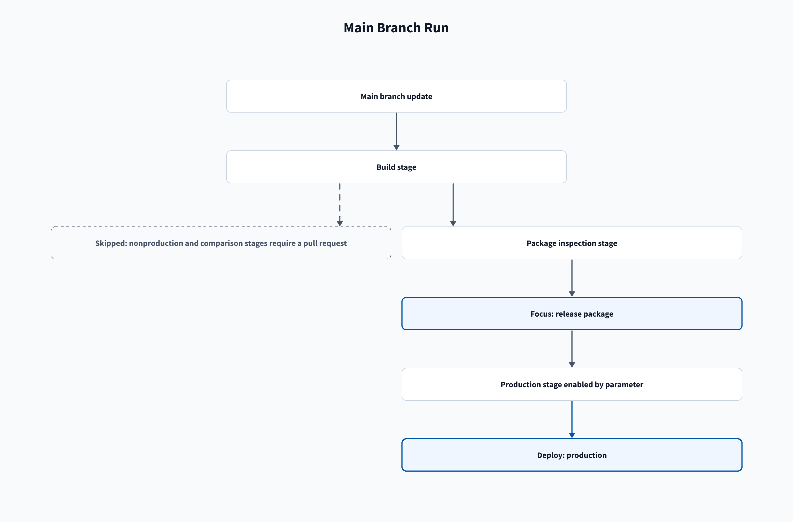

# App pipeline

[Home](/Home) > [Pipelines](/Pipelines) > App pipeline

[[_TOC_]]

Each app repository contains `package/` and an `azure-pipelines.yml` that
extends `templates/splunk-app.yml` from the shared tools repository, checked
out as `tools`. The template defaults to Python 3.13 and checks out the tools
repository. An app may override `setup` and `pool`.

Azure Repos queues pull request validation through a Build Validation policy.
The YAML `trigger` queues commits to `main`; Azure Repos ignores YAML `pr:`
triggers. `Show stage plan` prints the run reason and stage conditions.

The stage order is `build`, `appinspect`, `nonproddiff`, `nonprod`, `proddiff`,
`release`, and `prod`. `nonproddiff` displays as **Compare with nonprod** and
runs two parallel jobs that compare without installing.
`nonprod` displays as **Deploy to nonprod** and runs after `nonproddiff`.
`proddiff` displays as **Compare with prod** and runs after `nonprod`.
`release` depends on `proddiff` and runs on `main`. `prod` displays as
**Deploy to prod**, follows `release`, and waits for approval on `splunk-prod`
before installing. A rejection stops the stage. If approval reaches its
Timeout, Azure marks the stage skipped. Nothing installs to prod without
approval. See [Prod stage](/Stages/Prod).

The shared template also accepts the `importFromNonprod` and `importFromProd`
boolean runtime parameters. Both default to `false`, which keeps the stages
above. When one is selected, the run has an `import_<env>` stage for each
selected environment. It exports and compares the app installed on that ITSI
search head, then opens a pull request in the app repository.
See [Import from nonprod or prod](/Pipelines/App-import).

A pull request run that pushes a version bump stops after the build stage.
The bump commit starts a new run that validates the bumped version.

## Related

- [Stages](/Stages)
- [Build stage](/Stages/Build)
- [Nonproddiff stage](/Stages/Nonproddiff)
- [Nonprod stage](/Stages/Nonprod)
- [Proddiff stage](/Stages/Proddiff)
- [Prod stage](/Stages/Prod)
- [Import from nonprod or prod](/Pipelines/App-import)

---

[Next: Import from nonprod or prod >](/Pipelines/App-import)
