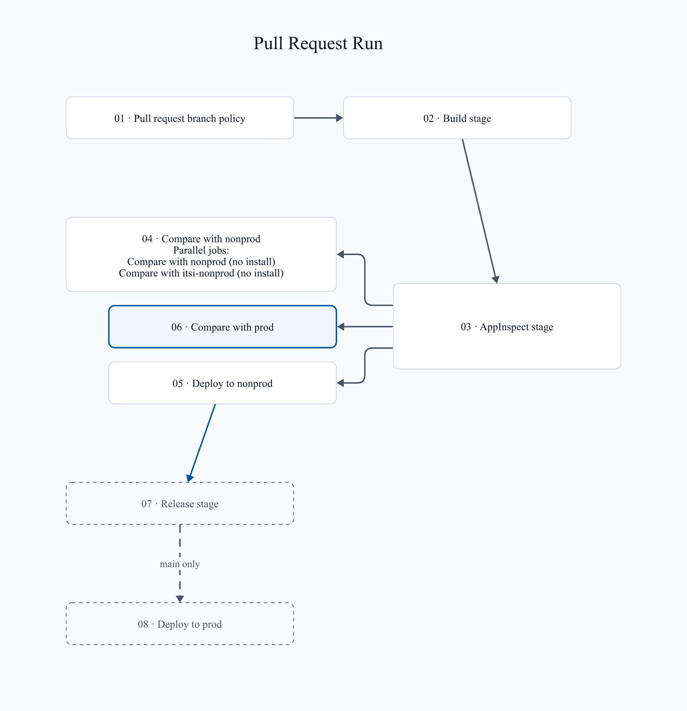
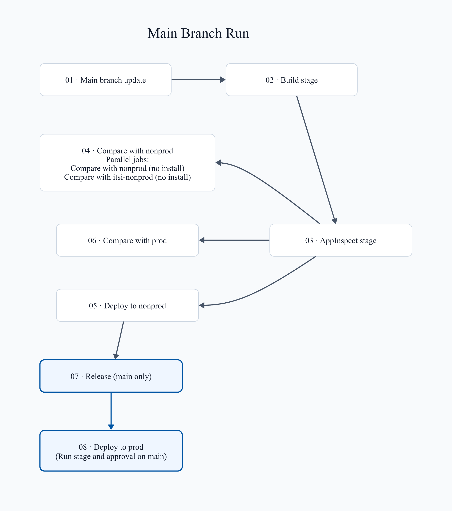

# App pipeline

Each app repository has `package/` and an `azure-pipelines.yml` that extends the shared template. The template uses
Python 3.13 and `ubuntu-latest` agents unless the app repository overrides `setup` or `pool`. For stages and outputs,
see [Reference: Stages](/Reference/Stages).

## Runs

- Pull request runs start from the Build validation policy on `main`. Azure Repos ignores YAML `pr:`
  triggers. See [Onboard: After onboarding](/Pipelines/Onboard#after-onboarding).
- Main runs start from the YAML trigger on `main`.
- The run name shows the import options. An app repository whose `azure-pipelines.yml` has no `name` line shows
  plain run numbers.

## Import

The import options export the installed app from the nonprod or prod ITSI search head. They compare it with the
package on `main`, then open a pull request. They install nothing. Each option uses its `splunk-itsi-<env>` group.

| Parameter | Values | Default | Effect |
| --- | --- | --- | --- |
| `importFromNonprod` | on, off | off | Adds the `import_nonprod` stage. It exports from nonprod and opens a pull request. |
| `importFromProd` | on, off | off | Adds the `import_prod` stage. It exports from prod and opens a pull request. |
| `importLookups` | on, off | off | On imports `lookups/` too. Off leaves `lookups/` out of both sides, and the pull request keeps the lookups on `main`. |

An app repository whose `azure-pipelines.yml` has no `importLookups` parameter never imports lookups. One
without `importFromProd` shows no prod option. Imports and compares always leave out
`lookups/lookup_file_backups/`, and an import removes it from the app.

### Run an import

1. Open **Pipelines**.
2. Open the app pipeline.
3. Select **Run pipeline**.
4. Select `main` as the branch.
5. Select **Import this app from nonprod into a new pull request** to import from nonprod.
6. Select **Import this app from prod into a new pull request** to import from prod.
7. Select **When importing, also import lookups (CSV files)** to import lookups too.
8. Select **Run**.
9. Open the [import diff artifact](/Reference/Artifacts).
10. Review the artifact.
11. Edit the pull request to choose what to keep, or close it to discard the import.

Each selected option makes its own stage and pull request, on a new branch named
`<env>-import/<version>-<Build.BuildId>`. The pull request auto-completes and deletes its branch once its policies
pass. Its validation run skips the version bump, because the imported version differs from `main`.

### Import every app at once

See [Azure CLI: Import every app from prod](/Pipelines/Azure-CLI#import-every-app-from-prod).

### What the import stage does

The `import_<env>` stage packages `main`, exports the app to `<env>-export/<app-id>/`, and runs the
[compare steps](/Reference/Stages#compare-steps) in reverse. Lines with `-` are the package on `main`. Lines with `+`
are `<env>`, the changes the import brings in. It publishes the diff artifact, then opens the pull request.

The pull request changes the export in these ways. Each changed setting prints one warning.

- Merges local configuration into default, and removes `local/`, `users/` and `metadata/local.meta`.
- Removes every `viewstates.conf`. Compare still shows it in the diff.
- Sets both version rows to one patch above the highest version on `main` or in the splunk-apps feed, and regenerates
  `app.manifest`.
- Sets `acceleration = false` in `datamodels.conf`, and removes `action.populate_lookup` from `savedsearches.conf`.
  Acceleration turned on in Splunk Web stays on after a deploy.
- Sets the `app.conf` settings Splunk Cloud AppInspect requires. Onboard, every package step and every pull request
  bump set the same ones:
  - `[id] name` and `[package] id` are the app ID.
  - `[id] version` and `[launcher] version` match the higher of the two. They default to `1.0.0`.
  - `[package] check_for_updates = false`.
  - `[ui] label` is 5 to 80 characters. It defaults to the app ID.
  - `[install] is_configured = true` becomes `false`. `install_source_checksum`,
    `install_source_local_checksum`, and `state_change_requires_restart` are removed.

## Check a run

| Stage or job | Expected result |
| --- | --- |
| `build` | Succeeds and publishes `dist`. |
| `appinspect` | Succeeds. Failure, error, and manual check counts are 0. |
| `nonproddiff` | Shows **Compare with nonprod**. Both jobs finish without installing. |
| `nonprod` | Shows **Deploy to nonprod** and installs the package. |
| `proddiff` | Shows **Compare with prod**. Both jobs finish without installing. |

1. Open the pipeline run.
2. Check each row in the table.
3. Open the `appinspect` job.
4. Open the **Show AppInspect HTML report link** step.
5. Select the link.
6. Open the `appinspect-report-<attempt>` artifact with the highest attempt number.
7. Download `appinspect-report.html`.
8. Open the file in a browser.

The **Show AppInspect JSON report** step prints the full report. A `future_failure` count above 0 shows a
warning. If the app is not in prod yet, the export log shows `NOT INSTALLED <app-id>`, and every package
file shows as added.

## Check a release

1. Merge the validated pull request into `main`.
2. Open the main pipeline run.
3. Confirm `build`, `appinspect`, and `release` pass.
4. Open **Repos**.
5. Open **Tags**.
6. Confirm `v<version>` points to the release commit.
7. Open **Artifacts**.
8. Open **splunk-apps**.
9. Find the package named with the lowercase app ID.
10. Confirm the feed has the version from `app.conf`.

If the tag or package is missing, see [Release troubleshooting](/Troubleshooting/Release).

## Approve the prod install

An approval for **Compare with prod** does not start **Deploy to prod**. To skip the prod install, leave **Run stage**
unselected.

1. Wait for **Release** to succeed. Optional: read **Compare with prod** first.
2. Open the run.
3. Select **Run stage** on **Deploy to prod**.
4. Approve the `splunk-prod` check. See [Deploy: Approve a stage](/Pipelines/Deploy#approve-a-stage).

Selecting **Run stage** too early fails at the first step. Select **Rerun stage** after **Release** succeeds.

A rejection stops the stage. If approval reaches its timeout, Azure marks the stage skipped. The Exclusive Lock check
runs after the approvals, so waiting for approval does not hold the prod lock.

If a stage skips or fails, see [Build troubleshooting](/Troubleshooting/Build).
