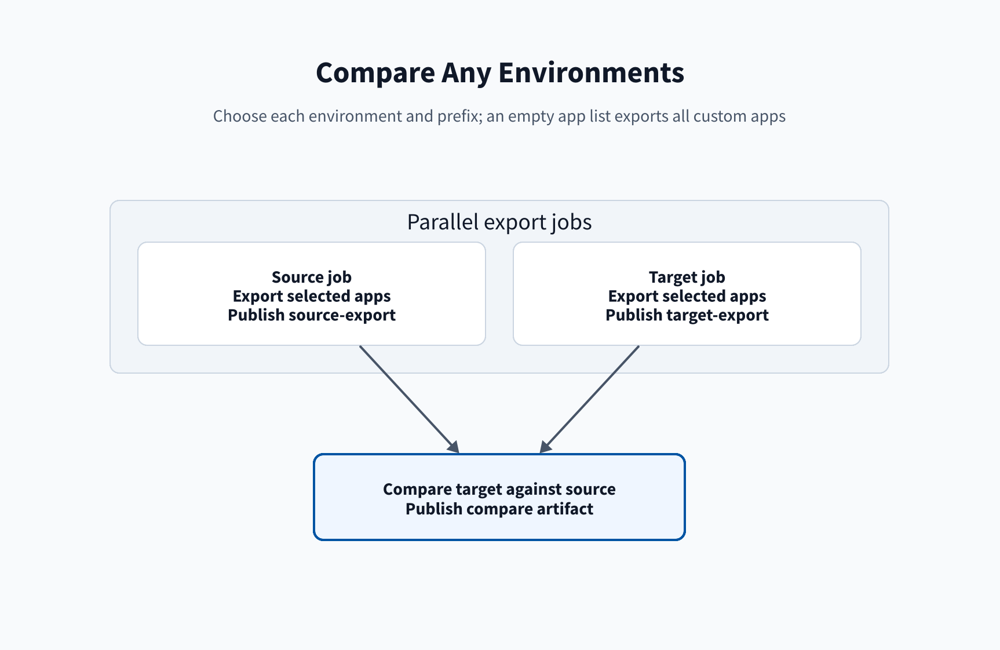

# Compare pipeline

[Home](/Home) > [Pipelines](/Pipelines) > Compare pipeline

[[_TOC_]]

## Inputs and jobs

The manual pipeline selects `source` and `target` environments independently, each
`nonprod` or `prod`, and a `groupPrefix` of `splunk` or `splunk-itsi`. The
default source is nonprod and the default target is prod. The `apps`
parameter defaults to `all`. `all`, or an empty value, exports every custom
app (every app not from Splunkbase) from each environment. Otherwise, it
exports the listed app ids. The compare job diffs target against source. An
app installed in only one environment shows every file as added or removed.

### Jobs `source` and `target` in the compare pipeline

- **Does:** Exports the selected app ids from the selected environment.
- **Inputs:** `groupPrefix`, environment, `SPLUNK_STACK`,
  `SPLUNK_SEARCH_HEAD`, `ACS_TOKEN`, and `apps`.
- **Outputs:** `<environment>-export` artifact.

Each export job selects Python 3.13 and runs **Set up ACS CLI 2.26.0 for
$(SPLUNK_STACK)** before export. When `apps` is `all` or empty, it calls
`release.py export --custom`; otherwise it passes the listed app ids to
`release.py export`. It then publishes its export directory. See
[release.py commands](/Reference/Release.py-commands) for the ACS setup
lifecycle.

### Job `compare` in the compare pipeline

- **Does:** Waits for both export jobs and compares target to source.
- **Inputs:** Source and target export artifacts, Python 3.13, `ksconf`, and
  Splunk SDK.
- **Outputs:** `compare` artifact.

Steps, in order:

- **UsePythonVersion@0:** Selects Python 3.13. **Inputs:** `versionSpec`.
  **Outputs:** Python on `PATH`.
- **Download artifacts (`download: current`):** Gets current-run exports.
  **Inputs:** Published artifacts. **Outputs:** Export directories.
- **Install diff dependencies:** Installs `ksconf` and Splunk SDK.
  **Inputs:** Python package index. **Outputs:** Diff tools in Python.
- **Compare `<target>` with `<source>` (file tree, local and default):** Runs
  `release.py tree`. **Inputs:** Target and source exports.
  **Outputs:** `<app-id>-tree.txt` in `compare/` with raw file changes.
- **Compare `<target>` with `<source>` (local files vs default):** Runs
  `release.py local-diff`. **Inputs:** Target and source exports.
  **Outputs:** `<app-id>-local-vs-default.diff` in `compare/`.
- **Compare `<target>` with `<source>` (merged defaults):** Runs
  `release.py diff`. **Inputs:** Target and source exports.
  **Outputs:** HTML, patch, summary, and merged archive files in `compare/`.
The `release.py diff` step adds each Markdown summary to the run summary tab.
- **Publish artifact (`compare`):** Publishes the reports.
  **Inputs:** Per-app reports from the three compare steps.
  **Outputs:** `compare` artifact.

## Related

- [Variable groups](/Reference/Variable-groups)
- [Artifacts](/Reference/Artifacts)

---

[< Previous: Deploy to production](/Pipelines/Deploy-to-production) |
[Next: Restart pipeline >](/Pipelines/Restart-pipeline)
