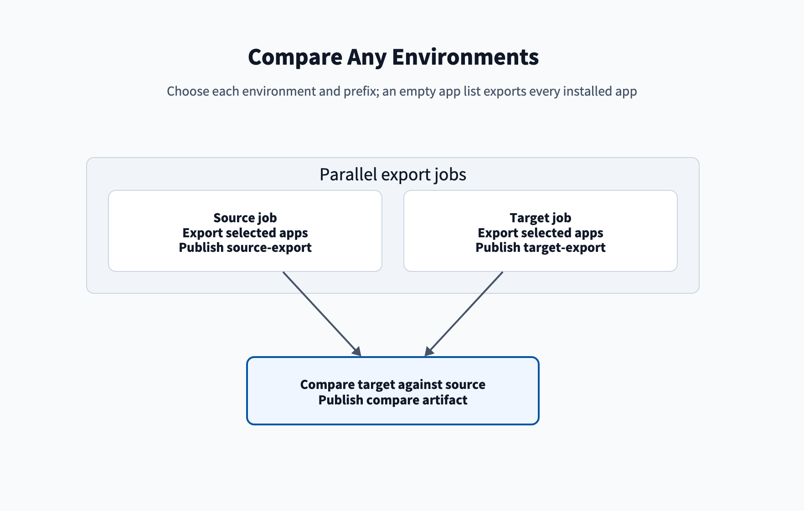

# Compare pipeline

The compare pipeline exports the apps from two environments and compares the target with the source. It
installs nothing.

The pipeline is named `compare-environments` in [Manual pipelines](/Setup/Manual-pipelines).

## Parameters

| Parameter | Values | Default | Effect |
| --- | --- | --- | --- |
| `source` | `nonprod`, `prod` | `nonprod` | Environment whose apps are compared. Files only here show as added. |
| `target` | `nonprod`, `prod` | `prod` | Environment compared against the source. Files only here show as removed. |
| `groupPrefix` | `splunk`, `splunk-itsi` | `splunk` | `splunk` uses `splunk-<env>`. `splunk-itsi` uses `splunk-itsi-<env>`. |
| `apps` | `all`, empty, or IDs separated by `;` | `all` | `all` or empty exports every installed app, private and Splunkbase. |

Use the app folder names from `[id] name` in `apps`, not display labels. For example: `my_app;other_app`.
An app installed in only one environment shows every file as added or removed.

Each export holds the app's default, local and user files and its app data. The export calls ACS once per app. Each
app's log starts with a timestamp and `Export <n> of <total>: <app>`, and the step ends with an `Export result` line.
Each export job can run for 6 hours. ACS limits some apps:

- The built-in `search` app exports only its local and user files. The log shows `LOCAL AND USERS ONLY search`.
- ACS does not export other built-in apps, premium apps such as ES and ITSI, or restricted Splunkbase apps. Each
  prints `SKIPPED <app>`, and the export goes on. The export fails only when ACS exports no app.
- User files cover only the users the token's account can access. Use an `sc_admin` account to get them all.

## Run it

1. Open the compare pipeline and select **Run pipeline**.
2. Select `source`, `target`, and `groupPrefix`.
3. Leave `apps` as `all`, or enter the app IDs separated by `;`.
4. Select **Run**.
5. Permit the source variable group and the target variable group when asked. See
   [Permissions](/Troubleshooting/Permissions).

Verify that the `source`, `target`, and `compare` jobs succeed. The `compare` artifact holds the reports for
each app. Report names are in [Reference: Artifacts](/Reference/Artifacts).

## What happens

- **Source and target jobs** run side by side. Each one uses Python 3.13, sets up the ACS CLI for its stack,
  exports the apps, and publishes `<environment>-export`. When `apps` is `all` or empty, the export runs
  `release.py export --all`. Otherwise it exports the listed IDs. The ACS setup is in
  [release.py commands](/Reference/Release.py-commands).
- **Compare job** waits for both exports. It sets up Python 3.13, `ksconf`, and the Splunk SDK, then downloads
  both exports. It runs the four compare steps in [Reference: Stages](/Reference/Stages#compare-steps), with
  the target compared against the source. It adds each app's Markdown summary to the run summary and publishes
  the `compare` artifact.
- **Cleanup:** after publishing, each job deletes its exports and compare files from the agent.

