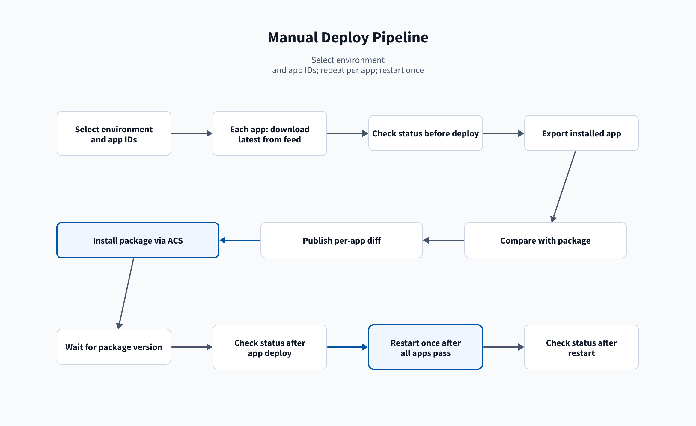
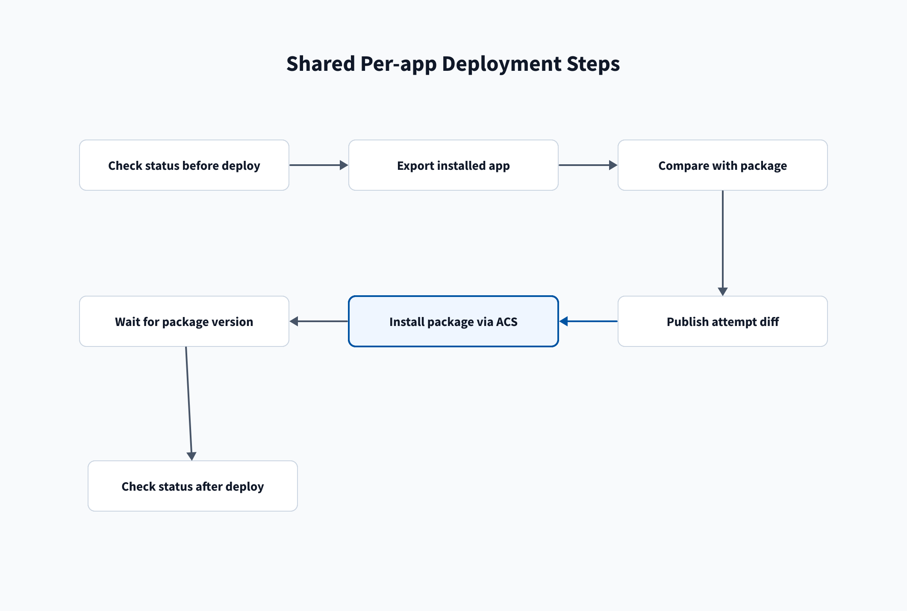

# Deploy pipeline

[Home](/Home) > [Pipelines](/Pipelines) > Deploy pipeline

[[_TOC_]]

## Run path

The pipeline in `deploy/azure-pipelines.yml` takes an environment and
space-separated app ids. The Run form parameter **DANGER - Uninstall each app
first. PERMANENTLY DELETES ALL of its lookups (CSV files) and local settings**
defaults off. The Run form parameter
**Restart both search heads - always after the uninstalls, after the installs
only if required. Unchecked never restarts** also defaults off. It
controls every restart: unchecked, the run never restarts either search head.
Every stage and job names the app and
environment, so a failure shows where it happened.

The stages run in this order. A run restarts at most twice:

1. **Stage `compare_<app>` (Compare `<app-id>` with `<environment>`)**, one
   per app: runs two jobs in parallel. **Compare with `<environment>` (no
   install)** uses `splunk-<environment>`, the main search head. **Compare with
   `itsi-<environment>` (no install)** uses `splunk-itsi-<environment>`, the
   ITSI search head. Both download the latest package, export the installed
   app, and compare without installing.
2. **Stage `uninstall_<app>` (Uninstall `<app-id>` from `<environment>`)**, one
   per app, only with the DANGER uninstall option: after the
   `splunk-<environment>` approval, the job **Uninstall from
   `itsi-<environment>`** runs, then the job **Uninstall from
   `<environment>`**.
3. **Stage `restart_uninstall` (Restart `<environment>` after the
   uninstalls)**, only when both the DANGER uninstall option and Restart are
   checked: runs after every
   uninstall stage succeeds. The job **Restart `itsi-<environment>` after the
   uninstalls** runs, then **Restart `<environment>` after the uninstalls**.
   Each always restarts, prints a warning to check the uninstall steps, and
   waits until the stack is Ready.
4. **Stage `deploy_<app>` (Install `<app-id>` on `<environment>`)**, one per
   app: the job **Install on `<environment>`** waits for the
   `splunk-<environment>` approval, then installs the package. With the
   uninstall option, it starts only after `restart_uninstall` succeeds, or,
   with Restart unchecked, after every uninstall stage succeeds.
5. **Stage `restart` (Restart `<environment>` if required)**, only when Restart
   is checked: runs after every install stage succeeds. The jobs **Restart
   `itsi-<environment>` if required** and **Restart `<environment>` if
   required** restart only when ACS reports `messages.restartRequired`, then
   check status.

All compare stages start at once. The exclusive lock check on
`splunk-<environment>` runs the other stages one at a time. Each of them waits
for the `splunk-<environment>` approval. A failed or rejected stage skips every
stage that depends on it. If Restart is unchecked, each app's **Check stack
status after deploy** step still reports a pending restart.

Both stages use `templates/feed-package.yml` to check the feed and download
the latest package. Compare stages use `templates/compare-stage.yml`. Deploy
stages use `templates/deploy-stage.yml`:

- **Use Python 3.13:** Prepares the agent in both stages.
- **Check `<app-id>` is in the splunk-apps feed:** Fails when the feed has no
  version of the app. Runs in both stages.
- **Download `<app-id>` from the splunk-apps feed:** Gets the latest package
  in both stages.
- **Install diff dependencies:** Installs the compare tools in both compare
  jobs.
- **Set up ACS CLI:** Prepares the ACS session in both stages. See
  [release.py commands](/Reference/Release.py-commands).
- **Check stack status before deploy:** Reads the selected stack status in
  both stages.
- **Export this app from `<side>` via ACS:** Exports the installed app
  in each compare job. An app that is not installed prints
  `NOT INSTALLED <app-id>`.
- **Compare `<side>` with this package (file tree, local and default):**
  Writes `<app-id>-tree.txt` with raw file changes.
- **Compare `<side>` with this package (local files vs default):**
  Writes the local-versus-default report.
- **Compare `<side>` with this package (merged defaults):** Writes the
  merged-default reports.
- **Compare `<side>` with this package (data models):** Prints each
  changed data model in its own collapsed group.
- **Publish the `<side>` compare artifact:** Publishes
  `<side>-diff-<app-id>-<attempt>` from each compare job.
- **Uninstall the app from `itsi-<environment>` via ACS**, then
  **Uninstall the app from `<environment>` via ACS:** Remove the app from the
  ITSI search head, then from the main search head, when the DANGER uninstall
  option is checked. Uninstall stage only. The `splunk-itsi-<environment>` ACS
  token needs the same app install capabilities as the main token.
- **Deploy to `<environment>` via ACS:** Installs the package in the deploy
  stage.
- **Wait for the deployed version:** Confirms the package version in the
  deploy stage.
- **Check stack status after deploy:** Reads the selected stack status in the
  deploy stage.

> **DANGER: uninstalling deletes ALL of the app's lookups.** Every CSV file in
> the app's `lookups/` folder on the stack, including lookups people edited or
> uploaded in Splunk Web, is deleted with the app, along with all of its local
> settings. The install that follows puts back only the lookups in the
> package. There is no undo. The `<app-id>-merged.tar.gz` file in the compare
> artifact holds the lookups as they were when the compare ran; anything
> changed after that is lost.

For the full production walkthrough, see
[Deploy to production](/Pipelines/Deploy-to-production).

## Related

- [Restart pipeline](/Pipelines/Restart-pipeline)
- [Artifacts](/Reference/Artifacts)

---

[< Previous: Import from nonprod or prod](/Pipelines/App-import) |
[Next: Deploy to production >](/Pipelines/Deploy-to-production)
