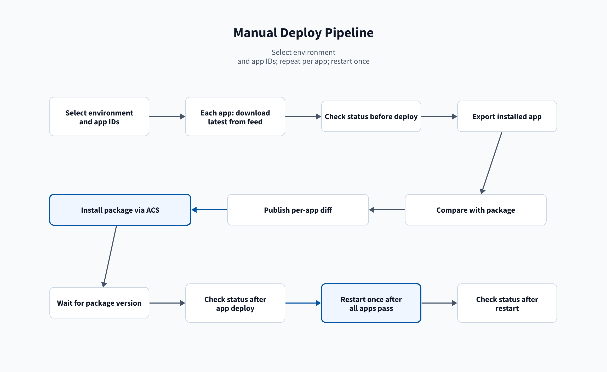
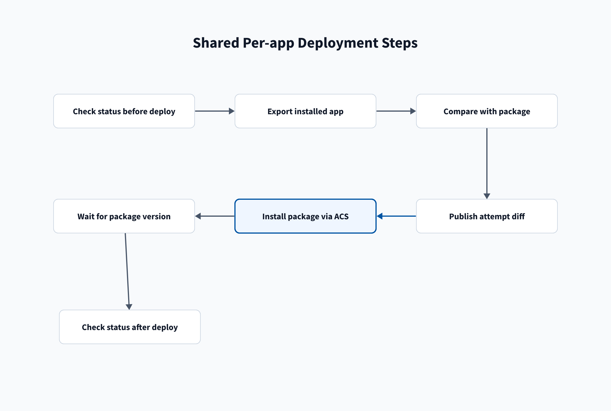

# Deploy pipeline

The Deploy pipeline installs released apps on nonprod or prod. It can also compare, uninstall and restart. It is
named `deploy-apps` in [Manual pipelines](/Setup/Manual-pipelines).

## Parameters

| Parameter | Values | Default | Effect |
| --- | --- | --- | --- |
| `environment` | `nonprod`, `prod` | `nonprod` | Stack to deploy to. Stages wait for the `splunk-<environment>` approval. |
| `apps` | App IDs separated by `;` | empty | Apps to deploy. An app whose `main` version is not in the splunk-apps feed is released first. |
| `compare` | on, off | on | Compare each app with the environment first. |
| `uninstall` | on, off | off | DANGER: uninstall each app first. Read [DANGER: uninstall](#danger-uninstall). |
| `install` | on, off | on | Install each app with one ACS bulk command. |
| `restart` | on, off | off | Restart both search heads at the end, if ACS requires it. |

To rerun part of a deployment, clear the parts that already succeeded.

## Run a deployment

1. Open **Pipelines**.
2. Open `deploy-apps`.
3. Select **Run pipeline**.
4. Select `nonprod` or `prod` for **Environment**.
5. Enter the app IDs in **App IDs separated by ;**.
6. Keep **Compare each app with the environment first** selected, unless you are rerunning part of a deployment.
7. Keep **Install each app** selected, unless you are rerunning part of a deployment.
8. Select **Restart both search heads at the end if required** to restart after the installs.
9. Select **Run**.
10. Permit each requested variable group and environment. If authorization stopped the run, rerun it. See
    [Permissions](/Troubleshooting/Permissions).
11. Approve each stage that waits. See [Approve a stage](#approve-a-stage).

Verify that the run shows one compare stage per app and one install stage.

## Stages

| Stage | Runs when | Waits for |
| --- | --- | --- |
| `release_missing` | App IDs are set. It packages, checks and uploads each app whose `main` version is not in the feed. | Nothing |
| `compare_<app>` | `compare` is on. | `release_missing` |
| `uninstall` | `uninstall` is on. | `release_missing`; every compare stage; approval |
| `restart_uninstall` | `uninstall` is on, whatever `restart` is. | `uninstall` |
| `install` | `install` is on. | `release_missing`; every compare stage; `restart_uninstall`; approval |
| `restart` | `restart` and `install` are on. | `install` |

- Each compare stage runs one job for the main search head and one for the ITSI search head. They install nothing.
  See [Compare steps](/Reference/Stages#compare-steps).
- Uninstall removes each app from all search heads, including ITSI, and confirms it is gone.
- Install and uninstall first check the stack every 5 seconds and start as soon as ACS reports `Ready`. Install then
  uses one ACS bulk command and confirms each app's exact version.
- Uninstall and the version check each wait up to 15 minutes for the stack.
- The restart stages are on [Restart stage](/Reference/Stages#restart-stage). If `restart` is off,
  **Check stack status after install** still reports a pending restart.
- The exclusive lock on `splunk-<environment>` runs deployment jobs one at a time.
- A failed or rejected stage skips every stage that depends on it. To deploy a rejected app later, start a new run
  with only that app ID.

For failures, see [Deploy troubleshooting](/Troubleshooting/Deploy).

## DANGER: uninstall

> **DANGER: uninstalling deletes ALL of each app's lookups.** Every CSV file in each app's `lookups/` folder
> on the stack is deleted with the app. That includes lookups edited or uploaded in Splunk Web. Local
> settings are deleted too. The install that follows puts back only the lookups in each package. There is
> no undo.
>
> Each `<app-id>-merged.tar.gz` file in the compare artifact holds that app's lookups as they were when the
> compare ran. Anything changed after that is lost.

The `apps` type of the [bulk delete](/Pipelines/Bulk) pipeline has the same effect.

## Approve a stage

1. Open the run.
2. Wait for every compare stage to succeed.
3. Open the waiting stage, for example **Install apps on prod**.
4. Select **Review**.
5. Select **Approve** to continue, or **Reject** to stop the stage.
6. Wait for the job to finish.
7. Confirm each step is green.

If `uninstall` was selected, approve the uninstall stage and its restart stage first. The install waits for them.
Restart stages use these same steps.

## Deploy to prod

1. Confirm `splunk-prod` has the **Approvals** check. See [Environments and ACS](/Setup/Environments-and-ACS).
2. Confirm `splunk-prod` has the **Exclusive Lock** check.
3. Open each app's pipeline.
4. Open its latest run on `main`.
5. Confirm every stage is green, including **Release**. If not, see [App: Check a release](/Pipelines/App#check-a-release).
6. Follow [Run a deployment](#run-a-deployment) with **Environment** set to `prod`. Leave
   **DANGER - Uninstall each app first** cleared.
7. Wait until every **Compare `<app-id>` with prod** stage is green.
8. Open a **Compare `<app-id>` with prod** stage.
9. Open the **Compare with prod** job.
10. Open **Compare prod with this package (file tree, local and default)**. `[added]` lines are files in the package
    that prod does not have. `[removed]` lines are files in prod that the package does not have.
11. Open **Compare prod with this package (local files vs default)**. Red `-` lines are prod local settings. Green `+`
    lines are the package's defaults.
12. Open **Compare prod with this package (merged defaults)**. Read each file's diff.
13. Open the **Compare with itsi-prod** job.
14. Repeat steps 10 to 12 for that job.
15. Repeat steps 8 to 14 for each app.
16. Approve **Install apps on prod**. See [Approve a stage](#approve-a-stage).

## Sharing

Knowledge object sharing (private, app, or global) is set in each app's `metadata/default.meta`. The app
deploys with that setting. ACS app-level read and write roles are managed in the separate ACS config
repository.

