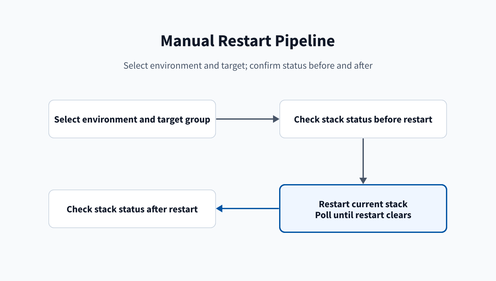

# Restart pipeline

Use this page to see restart pipeline inputs and status checks.

## Behavior

The manual restart pipeline selects `nonprod` or `prod` and group prefix
`splunk` or `splunk-itsi`. It checks status. When `messages.restartRequired`
is true, it restarts the current stack and polls until it is false. It then
checks status again.

The restart job uses `workspace: clean: all`, Python 3.13, the shared ACS CLI
template, and the selected variable group. **Set up ACS CLI 2.26.0 for
$(SPLUNK_STACK)** runs before the status and restart steps. ACS commands pass
the optional `SPLUNK_SEARCH_HEAD` value. See the
[ACS setup lifecycle](/Reference/Release.py-commands).

The steps are **Check stack status before restart**, **Restart the current
stack**, and **Check stack status after restart**.

