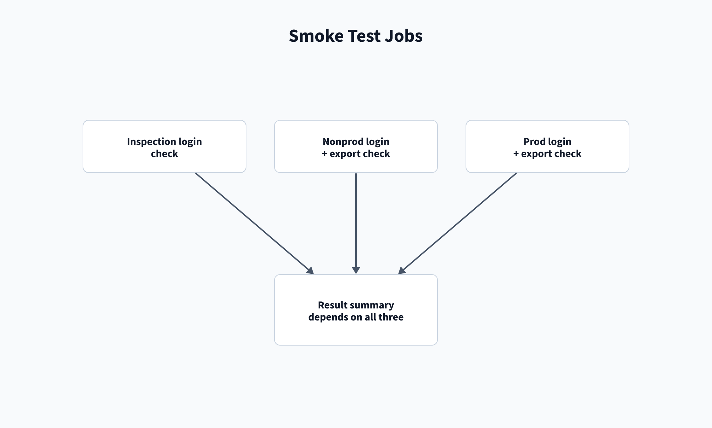

# Smoke-test pipeline

[Home](/Home) > [Pipelines](/Pipelines) > Smoke-test pipeline

[[_TOC_]]

The manual pipeline checks AppInspect credentials and read-only ACS access
for nonprod and prod. It selects the `splunk` or `splunk-itsi` target. The
`result` job runs even if a check fails and reports all three results.

The ACS jobs check login, list apps, and export only local and user
configuration files from the built-in `search` app. Compare exports full app
content, so do not include `search` in its app list.

## Related

- [Compare pipeline](/Pipelines/Compare-pipeline)
- [Troubleshooting](/Troubleshooting/Smoke-test)

---

[< Previous: Restart pipeline](/Pipelines/Restart-pipeline)
