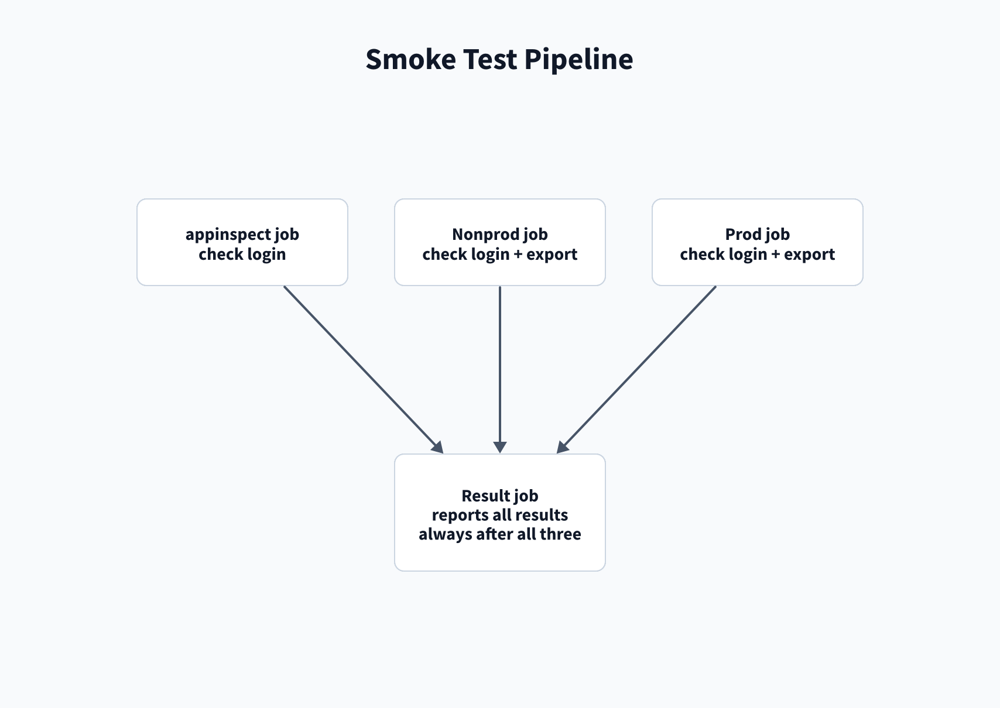

# Smoke test pipeline

The smoke test checks the AppInspect login, read-only ACS and search head access for nonprod and prod, and
the Azure DevOps rights that the app pipelines use. It changes nothing.

The pipeline is named `smoke-test` in [Manual pipelines](/Setup/Manual-pipelines). Complete the steps in
[Setup](/Setup) for the feed, variable groups, and environments and ACS tokens first.

## Parameters

| Parameter | Values | Default | Effect |
| --- | --- | --- | --- |
| `target` | `all`, `splunk`, `splunk-itsi` | `all` | Stacks to check. `all` checks both. Each gets a nonprod and a prod job that read `<target>-<env>`. |

## Run it

1. Open the smoke test pipeline and select **Run pipeline**.
2. Select **Run**. To check one stack only, first select `splunk` or `splunk-itsi` for **target**.
3. Permit the requested resources. See [Permissions](/Troubleshooting/Permissions).

Verify that the `appinspect`, `azuredevops`, `result`, and each `<target>_<env>` job finish, such as `splunk_itsi_prod`.

## Read the result

1. Open the run and then the `result` job.
2. Select the **Result** step.
3. Read its last line. It is `RESULT: ALL PASS`, or `RESULT: FAILED - open each failed job for its FAIL or
   Error line`.

## Checks

Each check prints one `PASS` line. A failed check prints one `FAIL <group>:` line. The `result` job runs after
the check jobs, including when a check fails.

| Check | What it proves | Fix |
| --- | --- | --- |
| `appinspect`: AppInspect login | The `splunk-appinspect` account logs in to splunk.com. Bulk Splunkbase commands use it too. | [Credentials][cred] |
| `<target>_<env>`: ACS login and app list | `SPLUNK_STACK` and `ACS_TOKEN` reach ACS and list apps. | [Credentials][cred] |
| `<target>_<env>`: export | The token exports the built-in `search` app's local and user files. | [Credentials][cred] |
| `<target>_<env>`: stack status | ACS returns the stack status and whether a restart is required. | [ACS][acs] |
| `<target>_<env>`: app listings | ACS lists installed apps and Splunkbase apps. Compare reads these lists for its custom export. | [ACS][acs] |
| `<target>_<env>`: search app version | ACS describes the `search` app. The deploy wait reads the same value. | [ACS][acs] |
| `<target>_<env>`: Test port 8089 | The token reads the `search` app `launcher` stanza over REST, as Repair does. Failure only warns. | [REST][rest] |
| `azuredevops`: onboard resources | Each variable group and environment that Onboard authorizes can be found. | [Azure DevOps][ado] |
| `azuredevops`: splunk-apps feed | The job token reads the `splunk-apps` feed. | [Azure DevOps][ado] |
| `azuredevops`: Contribute to pull requests | The Build Service has Contribute to pull requests on this repository. | [Azure DevOps][ado] |
| `result`: job results | Each job result, and whether all of them succeeded. | [Result][result] |

Not checked: bulk installs and updates, restarts, uninstalls, pull request creation, feed publishing, and ACS
app permissions. The Azure DevOps checks read only this repository, not the app repositories.

The groups that `target` selects are listed in [Reference: Variable groups](/Reference/Variable-groups).

If a check fails, see [Smoke test troubleshooting](/Troubleshooting/Smoke-test).

[cred]: /Troubleshooting/Smoke-test#credentials-or-acs-export-fails
[acs]: /Troubleshooting/Smoke-test#acs-status-or-app-listing-fails
[rest]: /Troubleshooting/Smoke-test#search-head-rest-read-fails
[ado]: /Troubleshooting/Smoke-test#azure-devops-rights-fail
[result]: /Troubleshooting/Smoke-test#read-the-smoke-test-result
