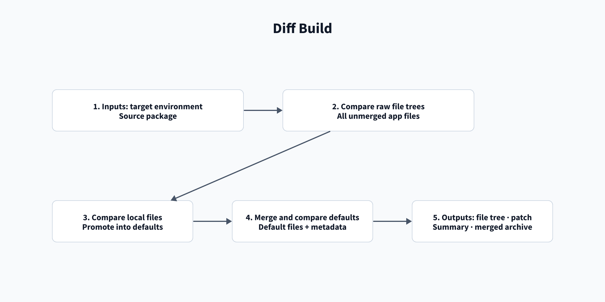

# Artifacts and diff reports

Use this page to identify the package, comparison, and release artifacts.

The `dist` artifact carries the package between app stages. AppInspect and compare artifacts include the job
attempt. Each app pipeline compare job publishes `<side>-diff-<app-id>-<attempt>`.

The `nonproddiff` artifacts are `nonprod-diff-<app-id>-<attempt>` and `itsi-nonprod-diff-<app-id>-<attempt>`.
The `proddiff` artifacts are `prod-diff-<app-id>-<attempt>` and `itsi-prod-diff-<app-id>-<attempt>`. Each
app folder contains these files:

- `<app-id>.patch`: changes under `default/` and `metadata/default.meta`.
- `<app-id>-merged.tar.gz`: the merged app, without `local/`, `metadata/local.meta`, or `users/`.

The summary lists deployed changes; target local files, which stay after deployment and override defaults; source
local files, which are not deployed; and user files. The nonprod compare adds the summary to the run summary. The
separate compare pipeline can select two environments. It exports all custom apps when the app list is `all` or
empty.

The import run publishes `<env>-diff-<app-id>-<attempt>` before it creates a pull request, where `<env>` is
`nonprod` or `prod`. Review this artifact with the proposed changes.

## Compare release tags

Open **Repos → Files → Compare** and select the two Git tags.

## Download a release package

Open **Artifacts → splunk-apps**, then select the app ID and version.

