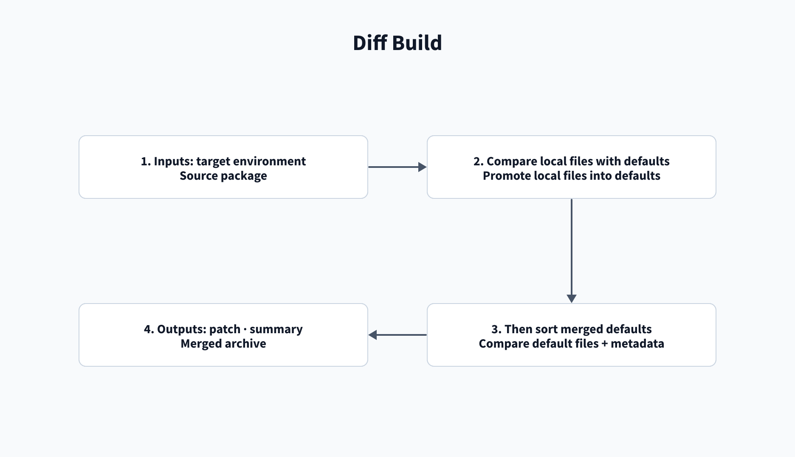

# Artifacts and diff reports

[Home](/Home) > [Reference](/Reference) > Artifacts and diff reports

[[_TOC_]]

The `dist` artifact carries the package between app stages. AppInspect and
diff artifacts include the job attempt. Compare export and compare artifacts
use fixed names.

A Proddiff `prod-diff-<attempt>` contains five reports:

- `<app-id>-diff.html`: folder tree, side-by-side changed-file tables, and the
  local-versus-default report.
- `<app-id>-summary.md`: deployed changes, target local files, source local
  files,
  and user files. Target local files remain after deployment, override defaults,
  and are not backed up.
- `<app-id>.patch`: changes under `default/` and `metadata/default.meta`.
- `<app-id>-local-vs-default.diff`: production local files against package
  defaults.
- `<app-id>-merged.tar.gz`: merged app without `local/`,
  `metadata/local.meta`, or `users/`.

The same summary is added to the run summary tab. The compare artifact contains
the HTML report, summary, patch, local-versus-default report, and merged
archive for each app. Compare can select two environments and export all custom
apps when the app list is empty.

## Compare release tags

Open **Repos → Files → Compare** and select the two Git tags.

## Download a release package

Open **Artifacts → splunk-apps**, then select the app id and version.

## Related

- [Proddiff stage](/Stages/Proddiff)
- [Compare pipeline](/Pipelines/Compare-pipeline)

---

[< Previous: Variable groups](/Reference/Variable-groups) |
[Next: Reading logs >](/Reference/Reading-logs)
