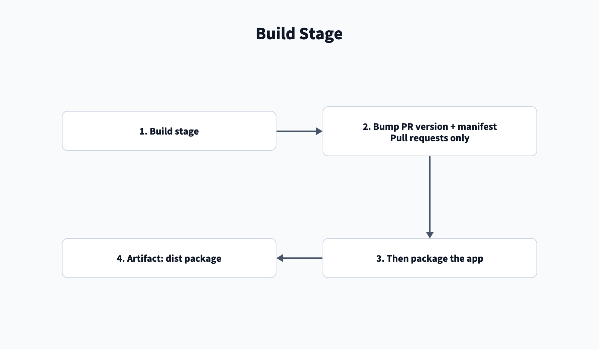

# Stages

Use this page to check when app pipeline stages run and what they produce. The last three sections cover the steps
and stages other pipelines share.

## App pipeline stages

| Order | Stage | Runs when | Produces |
| --- | --- | --- | --- |
| 1 | `build` | Every run with no import option selected | `dist` package artifact, or a pushed version bump. |
| 2 | `appinspect` | After `build`, unless it pushed a bump | AppInspect result and `appinspect-report-<attempt>` artifact. |
| 3 | `nonproddiff` | Pull request or `main`, after `appinspect` | Nonprod and ITSI compare artifacts. |
| 4 | `nonprod` | Pull request or `main`, after `nonproddiff` | App installed through ACS. |
| 5 | `proddiff` | Pull request or `main`, after `appinspect`; parallel with `nonprod` | Prod and ITSI compare artifacts. |
| 6 | `release` | `main`, after `nonprod` | Version tag and package in the feed. |
| 7 | `prod` | `main`, after **Run stage** and approval | App installed through ACS. |
| - | `import_nonprod`, `import_prod` | Each selected import option; no other stage runs | Compare artifact and pull request. |

- `appinspect` checks the `private_victoria` and `future` tags. Only a pass allows later stages.
- `release` skips the upload when the feed already has that version.
- `prod` stops unless `release` and `proddiff` succeeded. See
  [Approve the prod install](/Pipelines/App#approve-the-prod-install).
- For the import stages, see [App: Import](/Pipelines/App#import).

## Version bump rules

`release.py bump` runs only on pull request runs. It bumps when the source and target versions match and the target
has not changed the version. Otherwise it commits and pushes any `app.conf` change.

A bump starts from the higher of the target version and the feed versions. It sets `version` in `[launcher]` and
`[id]`, regenerates `app.manifest`, commits and pushes. That run skips packaging and later stages. The pushed commit
starts a new run that validates the package.

| Commit message contains | Bump |
| --- | --- |
| `[major]` | Major. Minor and patch reset to zero. |
| `[minor]` | Minor. Patch resets to zero. |
| Neither | Patch. |

## Compare steps

App, deploy, import and compare runs share these four steps. Each compare job publishes
`<side>-diff-<app-id>-<attempt>`. See [Artifacts](/Reference/Artifacts).

| Step | Output |
| --- | --- |
| File tree, local and default | Raw file changes, in the log. |
| Local files vs default | Local settings against the package defaults, in the log. |
| Merged defaults | `<app-id>.patch` and `<app-id>-merged.tar.gz`; stanza and line reports in the log; the summary in the run summary. |
| Data models | One collapsed log group per changed data model. |

## Bulk stage

The [bulk pipelines](/Pipelines/Bulk) run one ACS bulk command in a sequential deployment job on the selected
environment, so prod waits for its approval. Splunkbase installs fetch licenses first. With `restart` on, the restart
stage follows.

## Restart stage

The [Deploy pipeline](/Pipelines/Deploy#stages) and the [bulk pipelines](/Pipelines/Bulk) use this stage. It restarts
the ITSI search head first, then the main search head, of one environment. Each job restarts only when ACS reports that
a restart is required. Deploy's restart after an uninstall restarts both every time. After a restart request, each job
waits 60 seconds, then until the stack is `Ready` with no pending restart. The stage waits for the
`splunk-<environment>` approval, and its lock is sequential.
