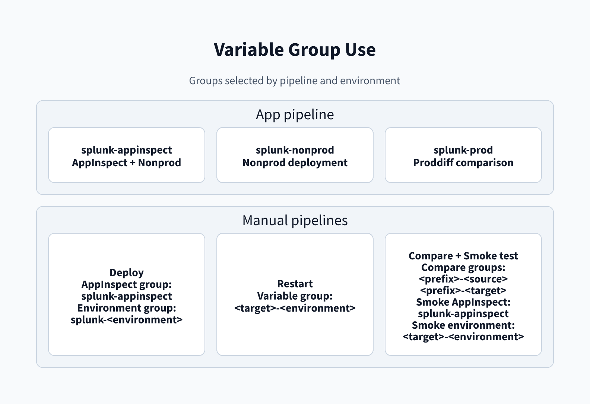

# Variable groups

[Home](/Home) > [Reference](/Reference) > Variable groups

[[_TOC_]]

## App pipeline

- `splunk-appinspect`: AppInspect and Nonprod.
- `splunk-nonprod`: Nonprod deployment.
- `splunk-prod`: Proddiff comparison.

## Manual pipelines

- Deploy uses `splunk-<environment>` for AppInspect and the selected
  environment.
- Restart selects the prefix and environment group for stack and optional
  search-head settings.
- Compare with target `splunk` uses `splunk-nonprod` and `splunk-prod`.
- Compare with target `splunk-itsi` uses `splunk-itsi-nonprod` and
  `splunk-itsi-prod`.
- Smoke test uses `splunk-appinspect` for login and the selected target group
  for Nonprod and Prod access checks.

Compare and smoke test select the `splunk` or `splunk-itsi` prefix. Keep
`SPLUNK_USERNAME`, `SPLUNK_STACK`, and `SPLUNK_SEARCH_HEAD` unlocked when
scripts read them directly. Keep secret values such as `SPLUNK_PASSWORD`
locked and map them in YAML.

## Related

- [Compare pipeline](/Pipelines/Compare-pipeline)
- [Smoke-test pipeline](/Pipelines/Smoke-test-pipeline)

---

[< Previous: Code layout](/Reference/Code-layout) |
[Next: Artifacts and diff reports >](/Reference/Artifacts)
