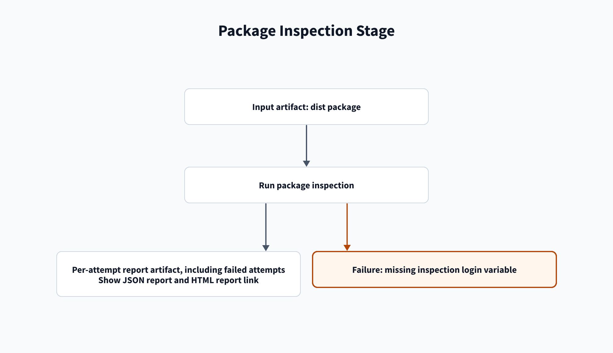

# AppInspect troubleshooting

[Home](/Home) > [Troubleshooting](/Troubleshooting) > AppInspect troubleshooting

[[_TOC_]]

## AppInspect stage

### `KeyError: 'SPLUNK_USERNAME'`

**Symptom:** `Run AppInspect` exits with `KeyError: 'SPLUNK_USERNAME'`.

**Cause:** Locked variables reach scripts only when mapped. The AppInspect
step maps the password, but reads the unlocked username variable directly.

**Fix:**

1. Keep `SPLUNK_USERNAME` unlocked in `splunk-appinspect`.
2. Keep `SPLUNK_STACK` unlocked in each stack group.
3. Keep `SPLUNK_SEARCH_HEAD` unlocked in each ITSI group.
4. Keep secret values such as `SPLUNK_PASSWORD` locked and mapped in YAML.

**Docs:** [Secret variables](https://learn.microsoft.com/en-us/azure/devops/pipelines/process/set-secret-variables),
[variable groups](https://learn.microsoft.com/en-us/azure/devops/pipelines/library/variable-groups).

### `ValueError: too many values to unpack (expected 1)`

**Symptom:** `Run AppInspect` or a deploy step stops at
`(pkg,) = Path(artifact_dir).glob("*.tar.gz")`.

**Cause:** The `dist` folder holds more than one package. Self-hosted agents
keep files between runs unless the job cleans its workspace.

**Fix:**

1. Open `templates/splunk-app.yml` in `azure-pipelines-splunk-apps`.
2. Check that every job has `workspace:` with `clean: all`.
3. Run the pipeline again.

**Docs:**
[Pipeline artifacts](https://learn.microsoft.com/en-us/azure/devops/pipelines/artifacts/pipeline-artifacts),
[Agents](https://learn.microsoft.com/en-us/azure/devops/pipelines/agents/agents)

### AppInspect login returns 401 or 403

**Symptom:** The log shows `HTTP 401` or `HTTP 403` from the AppInspect login
request to `api.splunk.com`.

**Cause:** The AppInspect username or password is incorrect, missing, or not
available to the script.

**Fix:**

1. Set `SPLUNK_USERNAME` to the account username in `splunk-appinspect`.
2. Set `SPLUNK_PASSWORD` to that account's password.
3. Keep the username unlocked and map the locked password to the script.
4. Rerun the `appinspect` job.

**Docs:** [AppInspect](https://dev.splunk.com/enterprise/docs/developapps/testvalidate/appinspect/),
[secret variables](https://learn.microsoft.com/en-us/azure/devops/pipelines/process/set-secret-variables).

### AppInspect does not pass

**Symptom:** The log prints `AppInspect did not pass` or a summary with
failures, errors, or manual checks.

**Cause:** The stage passes only when status is `SUCCESS` and the failure,
error, and manual check counts are all zero. A `future_failure` count adds a
warning, but does not fail this check.

**Fix:**

1. Open **Show AppInspect JSON report** in the failed job.
2. Open the link from **Show AppInspect HTML report link**.
3. Open `appinspect-report-<attempt>` for the failed job attempt.
4. Fix each reported failure, error, or manual check in the app.
5. Rerun validation after fixing the findings.

**Docs:** [AppInspect](https://dev.splunk.com/enterprise/docs/developapps/testvalidate/appinspect/),
[pipeline artifacts](https://learn.microsoft.com/en-us/azure/devops/pipelines/artifacts/pipeline-artifacts).

## Related

- [AppInspect stage](/Stages/AppInspect)
- [Artifacts](/Reference/Artifacts)

---

[< Previous: Build troubleshooting](/Troubleshooting/Build) |
[Next: Nonprod troubleshooting >](/Troubleshooting/Nonprod)
