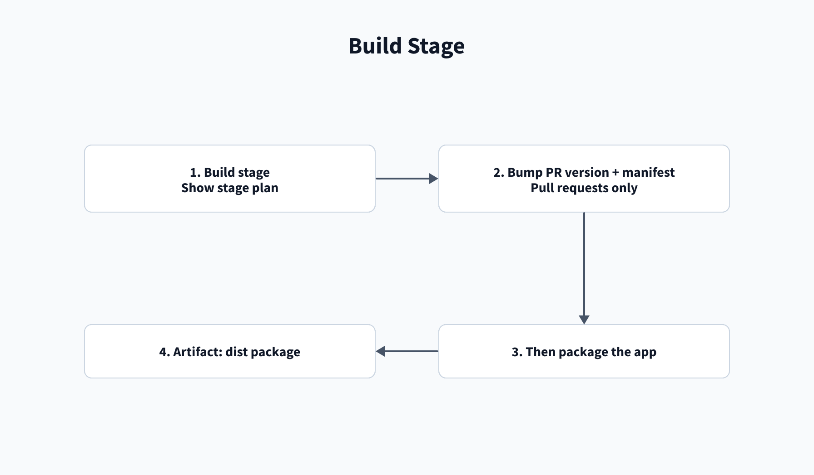

# Build troubleshooting

[Home](/Home) > [Troubleshooting](/Troubleshooting) > Build troubleshooting

[[_TOC_]]

## Build stage

### A stage after AppInspect is skipped

**Symptom:** `nonprod`, `proddiff`, or `release` is marked skipped.

**Cause:** `Show stage plan` prints the run reason, branch, and the condition
for each stage. `nonprod` and `proddiff` require a pull request or
`refs/heads/main`. `proddiff` depends on `nonprod`. `release` requires
`refs/heads/main`.

**Fix:**

1. Open the build job and read **Show stage plan**.
2. For pull requests, confirm the target branch has a Build Validation policy.
3. Add a Build Validation branch policy on the pull request target branch.
4. For `release`, run a build from `main` so the source ref is
   `refs/heads/main`.

**Docs:** [Conditions](https://learn.microsoft.com/en-us/azure/devops/pipelines/process/conditions),
[expressions](https://learn.microsoft.com/en-us/azure/devops/pipelines/process/expressions),
[branch policies](https://learn.microsoft.com/en-us/azure/devops/repos/git/branch-policies).

### Bump step prints a skip reason

**Symptom:** The step can print `target app.conf is missing, skipping bump`
or `version already changed, skipping bump`. `release.py` also has the
message `not a PR validation build, skipping bump`, but the pipeline condition
skips the step before it runs outside a pull request.

**Cause:** The bump runs only for a pull request. It also skips when the target
branch has no app config or already has a different version.

**Fix:**

1. Run pull request validation when a version bump is needed.
2. Add `package/default/app.conf` to the app repo if it is missing.
3. If the target version already changed, review that version before merging.

**Docs:** [Conditions](https://learn.microsoft.com/en-us/azure/devops/pipelines/process/conditions),
[Git commands](https://learn.microsoft.com/en-us/azure/devops/pipelines/scripts/git-commands).

### Bump push is rejected

**Symptom:** `Bump PR version and manifest` fails while pushing to the source
branch.

**Cause:** The project Build Service identity cannot contribute to the app
repository.

**Fix:**

1. Allow **Contribute** for the project Build Service identity on the app repo.
2. Rerun pull request validation.

**Docs:** [Git commands](https://learn.microsoft.com/en-us/azure/devops/pipelines/scripts/git-commands),
[branch policies](https://learn.microsoft.com/en-us/azure/devops/repos/git/branch-policies).

### Version mismatch in `app.conf`

**Symptom:** The log says that `[launcher]` and `[id]` need the same
`version` in `package/default/app.conf`.

**Cause:** The `[launcher]` and `[id]` version values differ or one is missing.

**Fix:**

1. Set the same version in `[launcher]` and `[id]` in
   `package/default/app.conf`.
2. Rerun the build.

**Docs:** [Packaging toolkit](https://dev.splunk.com/enterprise/docs/releaseapps/packagingtoolkit/).

### `ksconf sort` moves comments

**Symptom:** Comments move when the build sorts `.conf` files.

**Cause:** `ksconf sort` sorts configuration stanzas and keys.

**Fix:**

1. Add `KSCONF-NO-SORT` to the file comment to opt that file out of sorting.

**Docs:** [ksconf sort](https://ksconf.readthedocs.io/en/stable/cmd_sort.html).

### `Artifact ... already exists` on a rerun

**Symptom:** Publish reports that an artifact with the same name already
exists.

**Cause:** Names differ by output. The shared template uses the job attempt
for `appinspect-report` and the `*-diff` artifacts. The build `dist` artifact
and the compare pipeline's `nonprod-export`, `prod-export`, and `compare`
artifacts have fixed names.

**Fix:**

1. For a fixed-name artifact collision, start a new pipeline run.
2. For an attempt-named report or diff, open the artifact with the matching
   `System.JobAttempt` suffix.

**Docs:** [Pipeline artifacts](https://learn.microsoft.com/en-us/azure/devops/pipelines/artifacts/pipeline-artifacts).

## Related

- [Artifacts](/Reference/Artifacts)

---

[< Previous: Agent setup and network access](/Troubleshooting/Agent-setup) |
[Next: AppInspect troubleshooting >](/Troubleshooting/AppInspect)
