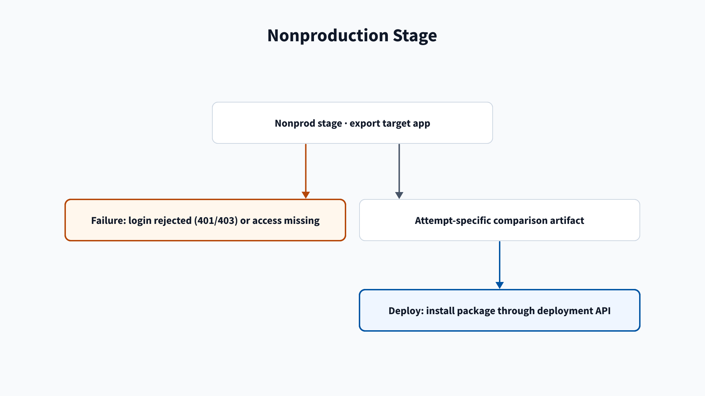

# Nonprod troubleshooting

Use this page to fix nonprod token, network, and ITSI export failures.

## Nonprod stage

### ACS token is rejected or lacks access

**Symptom:** An ACS command returns HTTP 401 or 403 during login, export, or
install.

**Fix:**

1. Set `SPLUNK_STACK` to the stack name used in its service URL.
2. Create the token on that stack or its selected search head.
3. Set the token audience to `acs`.
4. Grant the account `export_apps`, `install_apps`, and `edit_local_apps`.
5. Put the token in `ACS_TOKEN` in the matching variable group.
6. Rerun the failed job.

**Docs:** [ACS CLI](https://github.com/splunk/acs-cli),
[ACS export apps][acs-export].

### Agent address is missing from the ACS allowlist

**Symptom:** ACS requests from an agent fail even though stack and token
settings are correct.

**Fix:**

1. Add the agents' outbound addresses to the `acs` feature allowlist.
2. Add the agents' outbound addresses to the `search-api` feature allowlist.
3. Rerun the failed job.

**Docs:** [agents](https://learn.microsoft.com/en-us/azure/devops/pipelines/agents/agents),
[ACS export apps][acs-export].

### App is not installed on the nonprod ITSI search head

**Symptom:** The export logs `NOT INSTALLED <app-id>`, then the import step
reports that the `.tgz` export is missing.

**Fix:**

1. Install the app in nonprod through the app deployment pipeline.
2. Confirm `splunk-itsi-nonprod` has the nonprod ITSI search head in
   `SPLUNK_SEARCH_HEAD`.
3. Confirm the export step writes `<app-id>.tgz` under
   `nonprod-export/<app-id>/`.
4. Run the import option again.

For the stage flow, see [Nonprod stage](/Stages/Nonprod). For import behavior, see [Import from nonprod or prod](/Pipelines/App-import).

[acs-export]: https://help.splunk.com/en/splunk-cloud-platform/administer/admin-config-service-manual/10.5.2605/administer-splunk-cloud-platform-using-the-admin-config-service-acs-api/export-apps-in-splunk-cloud-platform
