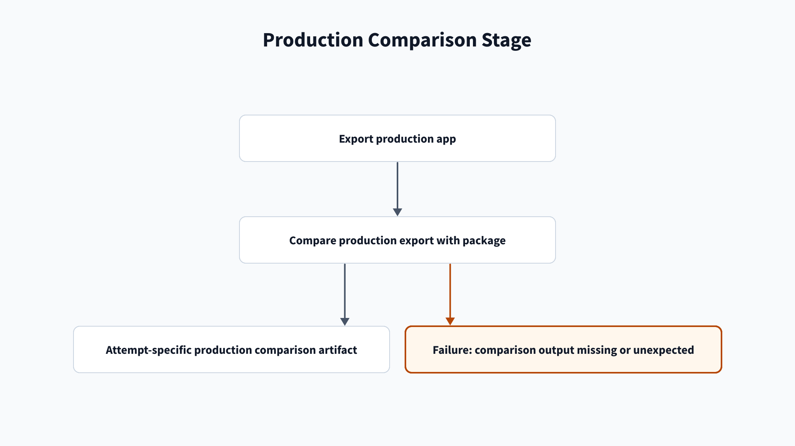

# Proddiff troubleshooting

[Home](/Home) > [Troubleshooting](/Troubleshooting) > Proddiff troubleshooting

[[_TOC_]]

## Proddiff stage

### Diff output is missing or unexpected

**Symptom:** The `prod-diff-<attempt>` artifact is missing, or the summary
shows added, changed, or removed defaults.

**Cause:** The export or diff command failed, or production differs from the
package. Local files are compared with matching package defaults before the
script promotes local files, sorts defaults, and compares deployed defaults.

**Fix:**

1. Read the first failed export or diff step in the `proddiff` job.
2. Open the `prod-diff-<attempt>` artifact for that job attempt.
3. Review the local-versus-default report, patch, and summary.
4. Update the app package or resolve the production difference before merge.

**Docs:** [ksconf filter](https://ksconf.readthedocs.io/en/stable/cmd_filter.html),
[ksconf diff](https://ksconf.readthedocs.io/en/stable/cmd_diff.html),
[ksconf promote](https://ksconf.readthedocs.io/en/stable/cmd_promote.html),
[ksconf sort](https://ksconf.readthedocs.io/en/stable/cmd_sort.html).

## Related

- [Proddiff stage](/Stages/Proddiff)
- [Artifacts](/Reference/Artifacts)

---

[< Previous: Nonprod troubleshooting](/Troubleshooting/Nonprod) |
[Next: Release troubleshooting >](/Troubleshooting/Release)
