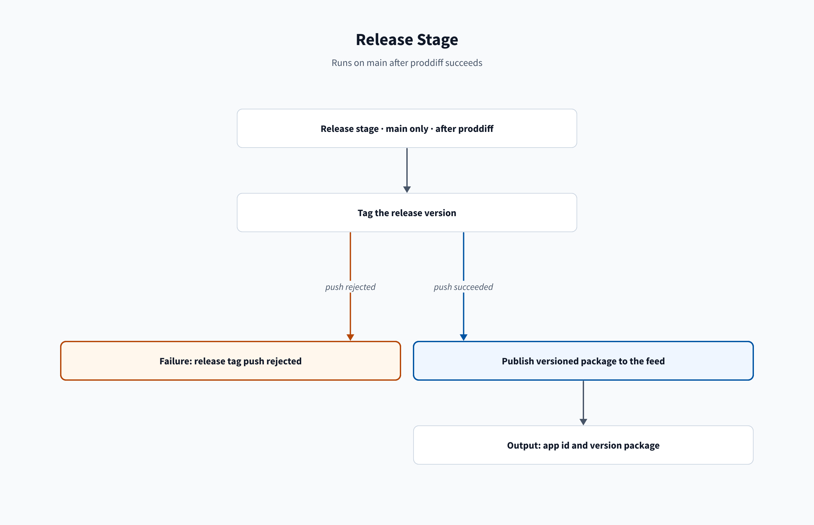

# Release troubleshooting

[Home](/Home) > [Troubleshooting](/Troubleshooting) > Release troubleshooting

[[_TOC_]]

## Release stage

### Tag push is rejected

**Symptom:** The tag step cannot push `v<version>` because the tag exists on
another commit.

**Cause:** A tag name already points to a different commit in the remote repo.

**Fix:**

1. Set a new unused version in both `[launcher]` and `[id]` in `app.conf`.
2. Merge the version change to `main`.
3. Rerun the release pipeline.

**Docs:** [Git commands](https://learn.microsoft.com/en-us/azure/devops/pipelines/scripts/git-commands),
[packaging toolkit](https://dev.splunk.com/enterprise/docs/releaseapps/packagingtoolkit/).

### Feed publish fails because the version exists

**Symptom:** Universal Package publish reports that the package version
already exists.

**Cause:** The feed already contains that app id and version.

**Fix:**

1. Set a new unused version in both `[launcher]` and `[id]` in `app.conf`.
2. Merge the version change to `main`.
3. Rerun the release pipeline.

**Docs:** [Universal Packages](https://learn.microsoft.com/en-us/azure/devops/artifacts/quickstarts/universal-packages),
[packaging toolkit](https://dev.splunk.com/enterprise/docs/releaseapps/packagingtoolkit/).

## Related

- [Release stage](/Stages/Release)

---

[< Previous: Proddiff troubleshooting](/Troubleshooting/Proddiff) |
[Next: Deploy troubleshooting >](/Troubleshooting/Deploy)
